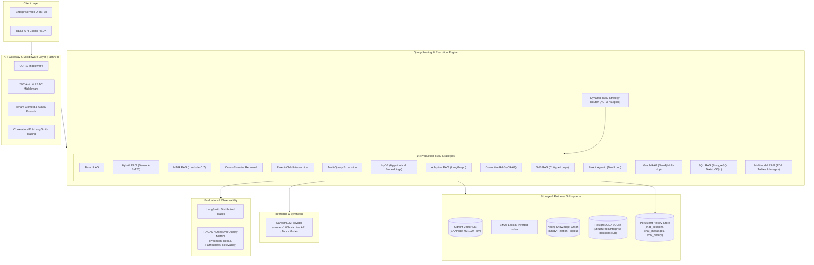
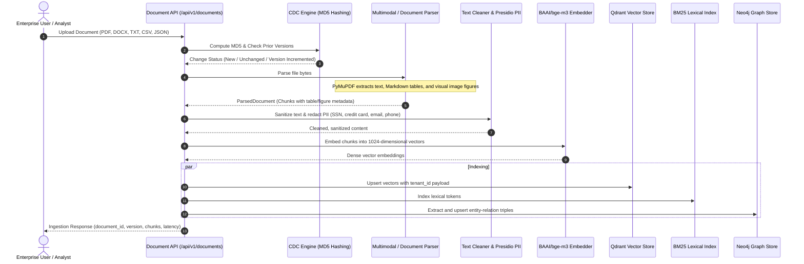

# High-Level Design (HLD) — Enterprise Multi-Architecture RAG & Agentic AI Platform

> **Target LLM**: Sarvam AI (`sarvam-105b`) | **Frameworks**: LangChain & LangGraph | **Vector Store**: Qdrant | **Graph Store**: Neo4j | **Relational DB**: PostgreSQL / SQLite | **Observability**: LangSmith

---

## 1. Executive Summary

This platform is an enterprise-grade, multi-architecture Retrieval-Augmented Generation (RAG) and Agentic AI system. It implements and compares 14 interchangeable RAG strategies side-by-side, supporting unstructured documents (PDF, DOCX, TXT, HTML, Markdown), structured data (PostgreSQL Text-to-SQL), knowledge graph relations (Neo4j GraphRAG), and multimodal figures/tables (PyMuPDF vector extraction).

All strategies leverage **Sarvam-105B** for generation, local **BAAI/bge-m3** for dense 1024-dimensional embeddings, **BGE Reranker** for deep cross-attention, and **LangSmith** for granular execution tracing.

---

## 2. End-to-End System Architecture

---

## 3. Core Architectural Subsystems

### 3.1 Document Ingestion & CDC Pipeline
The ingestion pipeline processes untrusted enterprise documents through a multi-stage hygiene and enrichment pipeline before indexing.

### 3.2 GraphRAG Subsystem (Neo4j)
- **Entity Extraction**: `GraphEntityExtractor` parses text chunks to extract `(Subject, Predicate, Object)` entity-relation triples.
- **Graph Indexing**: Triples are persisted via Cypher `MERGE` queries tagged with `tenant_id` and `doc_id`.
- **Hybrid Traversal**: For a user query, Qdrant dense vector search retrieves top candidate chunks, while Neo4j executes variable-length path traversals (`MATCH (s)-[*1..2]-(t)`). Relational knowledge facts are synthesized alongside text passages in `ContextBuilder`.

### 3.3 SQL RAG Subsystem (PostgreSQL Text-to-SQL)
- **AST Security Sandboxing**: `SQLValidator` parses generated SQL with `sqlglot`. It strictly enforces read-only operations (`Select`, `Union`, `With`), rejects data manipulation or DDL statements (`DROP`, `DELETE`, `INSERT`, `UPDATE`, `ALTER`, `TRUNCATE`), enforces table allowlists, and injects `LIMIT 1000`.
- **Database Catalog Grounding**: `SQLGenerator` extracts live table schemas and column types to formulate syntactically valid queries for `sarvam-105b`.
- **Execution & Formatting**: `SQLExecutor` queries the database with execution timeouts (5.0s max) and formats records into GitHub-flavored Markdown tables.

### 3.4 Multimodal RAG Subsystem (PyMuPDF)
- **Vector Table Extraction**: PyMuPDF's `find_tables()` converts vector cell boundaries into Markdown tables preserving numerical alignment.
- **Visual Figure Capturing**: `get_images()` extracts visual image properties (dimensions, colorspace, page numbers).
- **Intent Reranking**: Detects `TABLE_KEYWORDS` and `VISUAL_KEYWORDS` in queries to boost table and figure candidate scores by $+0.25$, prioritizing tabular and graphical answers.

### 3.5 Persistent History & Session Store (PostgreSQL / SQLite)
- **`chat_sessions`**: Tracks conversation sessions partitioned by `tenant_id` and `user_id`.
- **`chat_messages`**: Captures user inputs, assistant responses, model names, latency, token consumption, dollar costs, and JSON citations.
- **`evaluation_history`**: Persists RAGAS and DeepEval quality metrics over time for trend analytics.

---

## 4. Multi-Tenant Data Isolation (Zero Trust)

Every document, vector payload, relational record, audit event, and trace enforces strict `tenant_id` partitioning:
- **Qdrant**: `models.Filter(must=[models.FieldCondition(key="tenant_id", match=models.MatchValue(value=tenant_id))])` applied at search time.
- **Neo4j**: Every node and relationship stores `tenant_id` and is constrained during Cypher traversal.
- **PostgreSQL / SQLite**: All queries require `WHERE tenant_id = :tenant_id`.

---

## 5. Technology Stack Summary

| Layer | Technologies |
| :--- | :--- |
| **LLM Provider** | Sarvam AI (`sarvam-105b`) with fallback `MockLLMProvider` |
| **Frameworks** | LangChain Core, LangGraph (stateful agents), Pydantic v2 |
| **API Backend** | FastAPI, Uvicorn, ASGI Middleware, Starlette |
| **Vector DB** | Qdrant (HNSW index, Cosine distance, 1024-dim BGE-M3) |
| **Lexical Index** | Local In-Memory BM25 (Okapi BM25 implementation) |
| **Graph DB** | Neo4j (Cypher query language, APOC procedures) |
| **Relational DB** | PostgreSQL / SQLite (via SQLAlchemy and persistent store) |
| **Document Parsers** | PyMuPDF (PDF, tables, images), python-docx, Beautiful Soup 4 |
| **Security & Guardrails**| Presidio Analyzer & Anonymizer, `sqlglot` AST validator, PBKDF2-HMAC-SHA256, HS256 JWT |
| **Observability** | LangSmith (OpenTelemetry-compatible tracing), Prometheus metrics |
| **Package Manager** | `uv` (exclusively, frozen lockfile `uv.lock`) |
