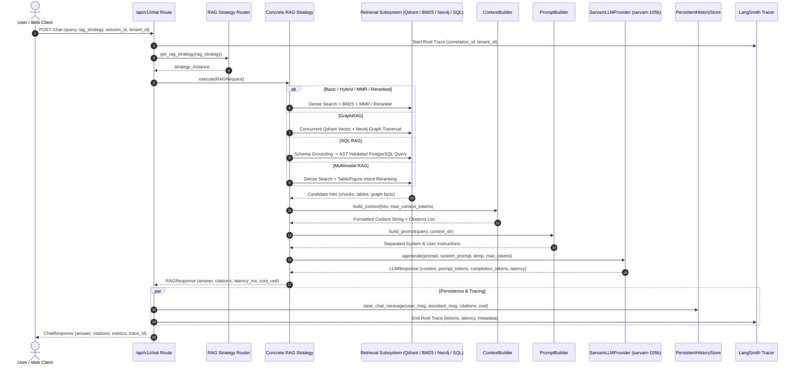
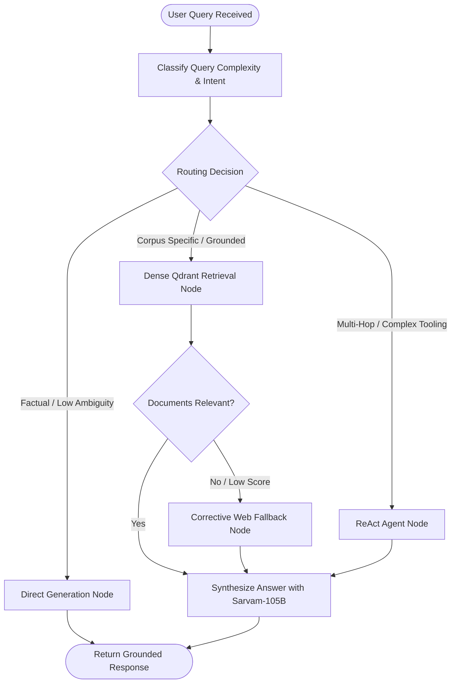
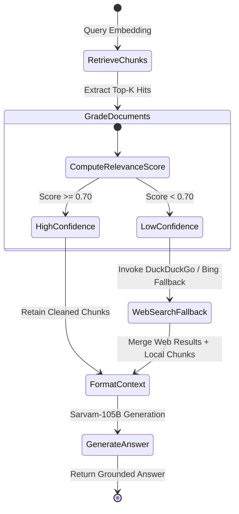
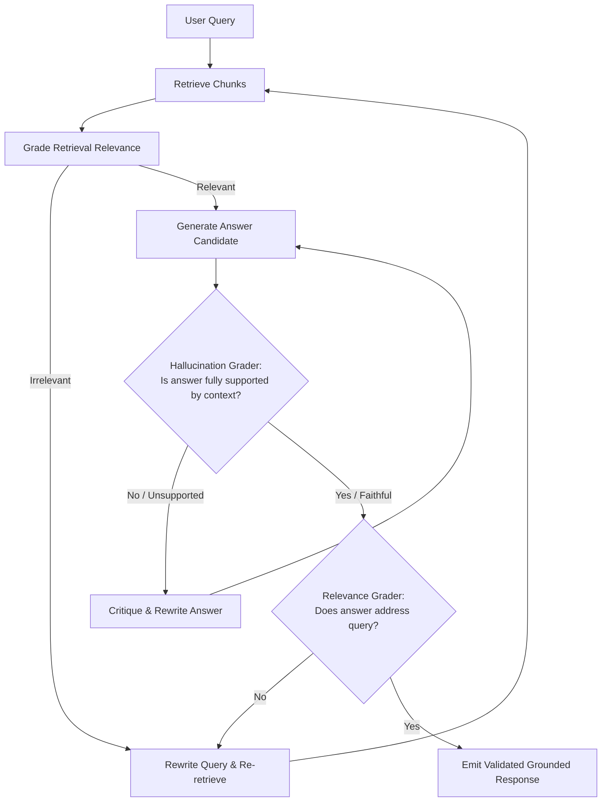
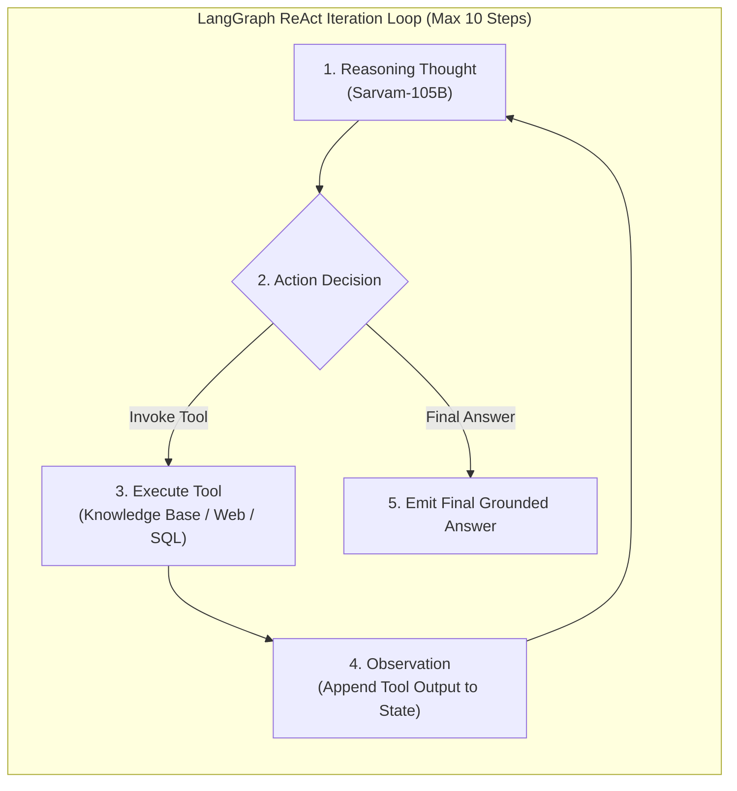
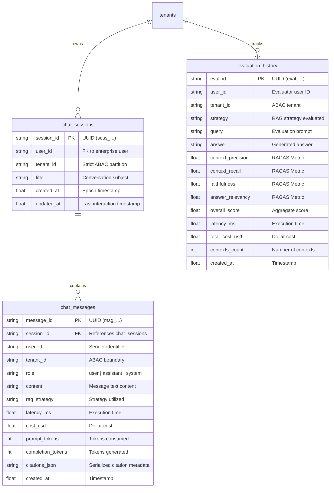

# Low-Level Design (LLD) & Technical Specification

> **Enterprise Multi-Architecture Production-Grade RAG & Agentic AI Platform**  
> **LLM**: Sarvam AI (`sarvam-105b`) | **Frameworks**: LangChain & LangGraph | **Vector DB**: Qdrant | **Graph**: Neo4j | **SQL**: PostgreSQL

---

## 1. Class Hierarchy & Architectural Abstractions

All RAG strategies inherit from the abstract base class `BaseRAGStrategy` in `backend/src/rag/base.py`, enforcing strict interface contracts, dependency injection, and uniform response schemas.

```mermaid
classDiagram
    class BaseRAGStrategy {
        <<abstract>>
        +vector_store: VectorStore
        +embedding_provider: BaseEmbeddingProvider
        +llm_provider: LLMProvider
        +context_builder: ContextBuilder
        +prompt_builder: PromptBuilder
        +execute(request: RAGRequest)* RAGResponse
    }

    class BasicRAGStrategy {
        +execute(request: RAGRequest) RAGResponse
    }

    class HybridRAGStrategy {
        +bm25_retriever: BM25Retriever
        +rrf_k: int = 60
        +execute(request: RAGRequest) RAGResponse
    }

    class MMRRAGStrategy {
        +lambda_mult: float = 0.7
        +execute(request: RAGRequest) RAGResponse
    }

    class RerankedRAGStrategy {
        +reranker: BaseReranker
        +fetch_k: int = 50
        +execute(request: RAGRequest) RAGResponse
    }

    class ParentChildRAGStrategy {
        +parent_store: ParentChunkStore
        +execute(request: RAGRequest) RAGResponse
    }

    class MultiQueryRAGStrategy {
        +query_generator: MultiQueryGenerator
        +execute(request: RAGRequest) RAGResponse
    }

    class HyDERAGStrategy {
        +hypo_generator: HypoDocumentGenerator
        +execute(request: RAGRequest) RAGResponse
    }

    class LangGraphBaseRAGStrategy {
        <<abstract>>
        +graph: CompiledStateGraph
        +build_graph()* StateGraph
    }

    class AdaptiveRAGStrategy {
        +router_node()
        +execute(request: RAGRequest) RAGResponse
    }

    class CorrectiveRAGStrategy {
        +evaluator_node()
        +fallback_node()
        +execute(request: RAGRequest) RAGResponse
    }

    class SelfRAGStrategy {
        +hallucination_grader_node()
        +relevance_grader_node()
        +execute(request: RAGRequest) RAGResponse
    }

    class ReActRAGStrategy {
        +agent_node()
        +tools: list~BaseTool~
        +execute(request: RAGRequest) RAGResponse
    }

    class GraphRAGStrategy {
        +graph_store: Neo4jGraphStore
        +execute(request: RAGRequest) RAGResponse
    }

    class SQLRAGStrategy {
        +sql_generator: SQLGenerator
        +sql_validator: SQLValidator
        +sql_executor: SQLExecutor
        +execute(request: RAGRequest) RAGResponse
    }

    class MultimodalRAGStrategy {
        +table_keywords: set~str~
        +visual_keywords: set~str~
        +execute(request: RAGRequest) RAGResponse
    }

    BaseRAGStrategy <|-- BasicRAGStrategy
    BaseRAGStrategy <|-- HybridRAGStrategy
    BaseRAGStrategy <|-- MMRRAGStrategy
    BaseRAGStrategy <|-- RerankedRAGStrategy
    BaseRAGStrategy <|-- ParentChildRAGStrategy
    BaseRAGStrategy <|-- MultiQueryRAGStrategy
    BaseRAGStrategy <|-- HyDERAGStrategy
    BaseRAGStrategy <|-- LangGraphBaseRAGStrategy
    BaseRAGStrategy <|-- GraphRAGStrategy
    BaseRAGStrategy <|-- SQLRAGStrategy
    BaseRAGStrategy <|-- MultimodalRAGStrategy

    LangGraphBaseRAGStrategy <|-- AdaptiveRAGStrategy
    LangGraphBaseRAGStrategy <|-- CorrectiveRAGStrategy
    LangGraphBaseRAGStrategy <|-- SelfRAGStrategy
    LangGraphBaseRAGStrategy <|-- ReActRAGStrategy
```

---

## 2. End-to-End Query Execution Flow Diagram

This flow diagram illustrates the lifecycle of a user request through the FastAPI gateway, strategy router, retrieval subsystems, synthesis engine, and persistent storage.

---

## 3. LangGraph Agent Workflows (Stateful RAG Workflows)

### 3.1 Adaptive RAG Graph Workflow
Analyzes incoming query complexity and routes dynamically between Direct LLM generation, Dense Vector search, and ReAct multi-step retrieval.

---

### 3.2 Corrective RAG (CRAG) State Machine
Grades retrieved document confidence. If confidence is insufficient, it triggers dynamic web query expansion before generation.

---

### 3.3 Self-RAG Critique & Reflection Graph
Evaluates retrieved context and generated answers through two reflection loops: (1) Is the retrieval relevant? (2) Is the generated answer faithful (free from hallucinations)?

---

### 3.4 ReAct Agent Tool Execution Loop
LangGraph stateful Thought-Action-Observation loop with hard bounds (max 10 iterations).

---

## 4. Mathematical Specifications & Core Algorithms

### 4.1 Reciprocal Rank Fusion (RRF)
Used in Hybrid RAG, Multi-Query RAG, and Parent-Child fusion to merge ranked candidate lists without needing calibrated score normalization:

$$\text{RRF\_Score}(d) = \sum_{m \in M} \frac{1}{k + r_m(d)}$$

Where:
- $M$: Set of retrieval systems (e.g. $M = \{\text{Qdrant Dense}, \text{BM25 Sparse}\}$).
- $r_m(d)$: Rank position of document $d$ in retrieval system $m$ (1-indexed).
- $k$: Smoothing constant (standardized to $k = 60$).

---

### 4.2 Maximal Marginal Relevance (MMR)
Balances query relevance with pairwise candidate diversity to eliminate redundant snippets from retrieved context:

$$\text{MMR}(Q, R, S) = \arg\max_{d_i \in R \setminus S} \left[ \lambda \cdot \text{Sim}_1(d_i, Q) - (1 - \lambda) \cdot \max_{d_j \in S} \text{Sim}_2(d_i, d_j) \right]$$

Where:
- $Q$: User query vector.
- $R$: Candidate set retrieved from Qdrant.
- $S$: Subset of documents already selected into context.
- $\text{Sim}_1, \text{Sim}_2$: Cosine similarity functions.
- $\lambda$: Diversity factor (configured to $\lambda = 0.70$).

---

### 4.3 Multimodal Modality-Aware Scoring
Detects tabular and visual tokens in user queries to boost matching chunk types:

$$\text{Score}_{\text{boosted}}(c) = \min\left( \text{Score}_{\text{base}}(c) + \Delta_{\text{modality}}, \, 1.0 \right)$$

$$\Delta_{\text{modality}} = 
\begin{cases} 
+0.25 & \text{if } Q \cap \text{TABLE\_KEYWORDS} \neq \emptyset \text{ and } c.\text{type} = \text{"table"} \\
+0.25 & \text{if } Q \cap \text{VISUAL\_KEYWORDS} \neq \emptyset \text{ and } c.\text{type} = \text{"figure"} \\
0.0 & \text{otherwise}
\end{cases}$$

---

### 4.4 Dynamic Request Cost Calculation
Cost is calculated dynamically per request using pricing parameters in `backend/config/pricing.yaml`:

$$\text{Cost}_{\text{total}} = \left( \frac{N_{\text{prompt}}}{1000} \cdot P_{\text{prompt}} \right) + \left( \frac{N_{\text{completion}}}{1000} \cdot P_{\text{completion}} \right) + \left( \frac{N_{\text{retrieved}}}{1000} \cdot P_{\text{vector}} \right)$$

Where $P_{\text{prompt}} = \$0.0030$, $P_{\text{completion}} = \$0.0060$, and $P_{\text{vector}} = \$0.0001$.

---

## 5. Relational Database Schema Design (PostgreSQL / SQLite)

The persistent history storage engine (`backend/src/storage/history.py`) defines three relational tables:

---

## 6. Error Handling & Resilient Fallback State Machines

1. **Sarvam-105B API Call Failures**:
   - Uses `tenacity` retry with exponential backoff (`wait_exponential(multiplier=1, min=2, max=10)`) up to 3 attempts.
   - If live API fails or key is missing, switches automatically to `MockLLMProvider` ensuring zero downtime.
2. **Neo4j Graph Connection Failures**:
   - If the remote Neo4j bolt connection fails, `Neo4jGraphStore` automatically transitions to an in-memory NetworkX/BFS fallback store to preserve multi-hop reasoning.
3. **Qdrant Vector DB Degradation**:
   - If Qdrant search returns empty or times out, hybrid RAG strategies gracefully fall back to BM25 lexical keyword matching.
4. **AST SQL Validation Rejection**:
   - When generated SQL fails security validation (`sqlglot`), the system intercepts the execution, logs a security audit event, and requests query rewriting without executing against the database.
