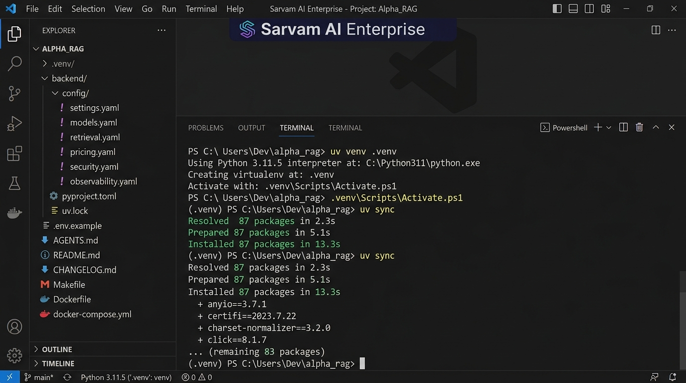

# Phase 0 — Project Setup

**Feature**: Repository initialization, `uv` virtual environment, `pyproject.toml`, config schemas  
**Status**: ✅ Complete  
**Git Branch**: `main`  
**Version**: v1.0.0

## What Was Built
- Initialized repo with `uv venv .venv` and `uv sync`
- Created `pyproject.toml` with all dependencies pinned
- Created `.env.example` with placeholder-only secrets
- Created `backend/config/*.yaml`: `settings.yaml`, `models.yaml`, `retrieval.yaml`, `pricing.yaml`, `security.yaml`, `observability.yaml`
- Created `AGENTS.md` (coding standards), `README.md`, `CHANGELOG.md`, `LICENSE`, `Makefile`
- Created `.gitignore` (excludes `.env`, `.venv`, `__pycache__`, vector DB data)

## Screenshot Proof

## Key Files
- `pyproject.toml` — dependency manifest
- `backend/config/` — all YAML configurations
- `.env.example` — environment template
- `Makefile` — dev automation

## Test Evidence
- `uv sync` completes without errors
- All config YAML files load via Pydantic settings validation
