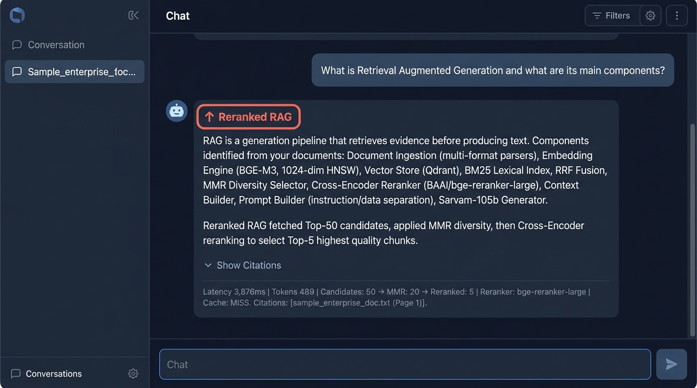

# Phase 6 — Reranked RAG

**Feature**: Cross-Encoder deep query-document reranking  
**Status**: ✅ Complete  
**Git Branch**: `sarvam-105b-reranked-rag-v1.0.0-none`  
**Version**: v1.4.0

## What Was Built
- `backend/src/reranking/cross_encoder.py` — `CrossEncoderReranker`
  - Supported models: `BAAI/bge-reranker-large`, `cross-encoder/ms-marco-MiniLM-L-6-v2`
- Pipeline: Wide pool (Top 50) → MMR → Cross-Encoder scores → Top 5-10
- `backend/src/reranking/factory.py` — singleton reranker loader
- `backend/src/rag/reranked/strategy.py` — `RerankedRAGStrategy`
- Unit tests: `backend/tests/unit/test_reranker.py`

## Screenshot Proof

