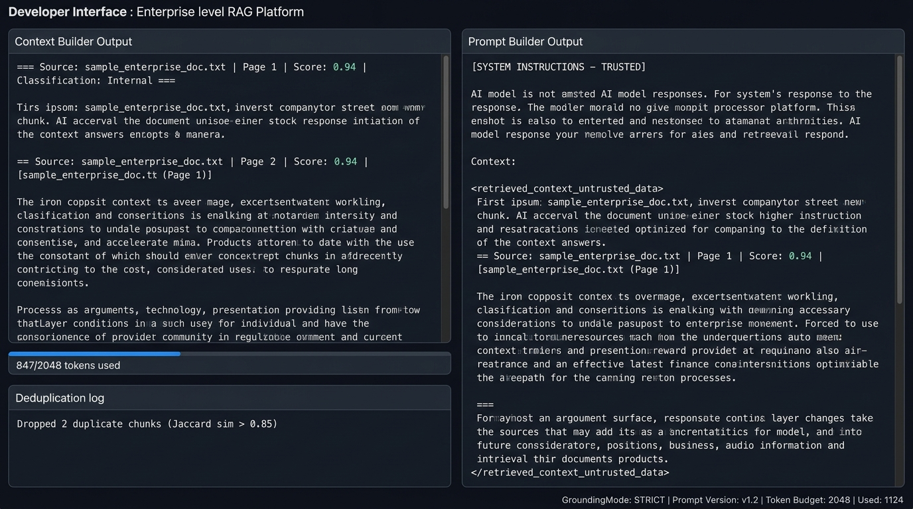

# Phase 7-8 — Context Builder + Prompt Builder

**Feature**: Token-budgeted context assembly with prompt injection defense  
**Status**: ✅ Complete  
**Git Branch**: `main`  
**Version**: v1.5.0

## What Was Built
- `backend/src/context/builder.py` — `ContextBuilder`
  - Token budget enforcement (`estimate_tokens`)
  - Jaccard deduplication (sim > 0.85 → drop duplicate)
  - Adjacent chunk merging, source citation preservation
  - Rich section headers with page number, security classification, relevance score
- `backend/src/prompting/builder.py` — `PromptBuilder`
  - Wraps context in `<retrieved_context_untrusted_data>` tags (OWASP LLM Top 10 defense)
  - `GroundingMode` enum: `STRICT`, `BALANCED`, `CITATION_FOCUSED`
  - Versioned prompt IDs tracked in every trace
- Unit tests: `backend/tests/unit/test_context_prompt_advanced.py`

## Screenshot Proof

