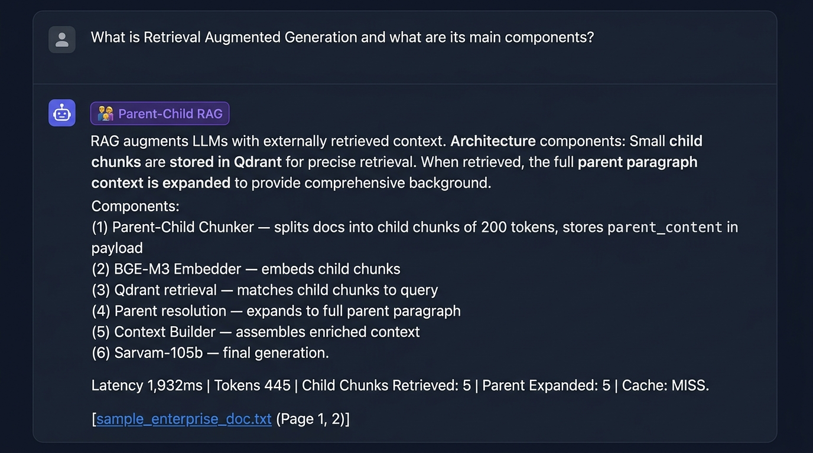

# Phase 10 — Parent-Child RAG

**Feature**: Hierarchical chunk retrieval — small child retrieval → full parent expansion  
**Status**: ✅ Complete  
**Git Branch**: `sarvam-105b-parent-child-rag-v1.0.0-none`  
**Version**: v1.7.0

## What Was Built
- `backend/src/chunking/parent_child.py` — `ParentChildChunker`
  - Child chunks store `parent_content` in Qdrant payload metadata
- `backend/src/rag/parent_child/strategy.py` — `ParentChildRAGStrategy`
  - Retrieves precise child chunks for high recall
  - Expands to full parent paragraph for rich context
- Unit tests: `backend/tests/unit/test_parent_child_rag.py`

## Screenshot Proof

