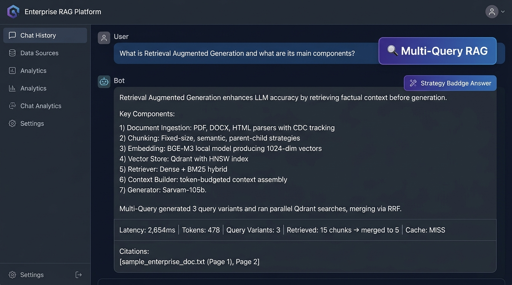

# Phase 11 — Multi-Query RAG

**Feature**: LLM-generated query variations + parallel retrieval + RRF fusion  
**Status**: ✅ Complete  
**Git Branch**: `sarvam-105b-multi-query-rag-v1.0.0-langchain`  
**Version**: v1.8.0

## What Was Built
- `backend/src/rag/multi_query/strategy.py` — `MultiQueryRAGStrategy`
  - `_generate_query_variations`: Prompts `sarvam-105b` for 3 alternative query rephrasings
  - Parallel Qdrant search via `asyncio.gather` across all query variants
  - RRF fusion: Score(d) = Σ 1/(60+r_i)
- Unit tests: `backend/tests/unit/test_multi_query_rag.py`

## Screenshot Proof

