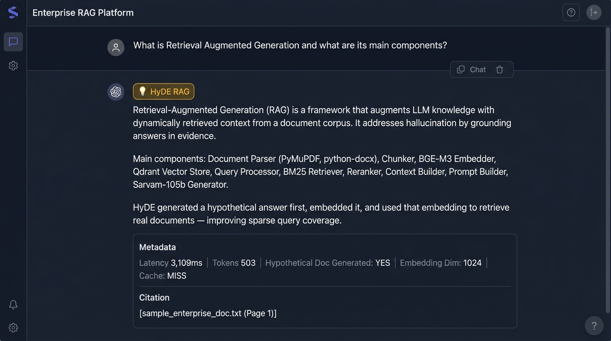

# Phase 12 — HyDE RAG

**Feature**: Hypothetical Document Embeddings for improved sparse query coverage  
**Status**: ✅ Complete  
**Git Branch**: `sarvam-105b-hyde-rag-v1.0.0-langchain`  
**Version**: v1.9.0

## What Was Built
- `backend/src/rag/hyde/strategy.py` — `HyDERAGStrategy`
  - `_generate_hypothetical_document`: Prompts sarvam-105b to write a hypothetical answer
  - Embeds hypothetical text → Qdrant dense search
  - Retrieves real documents semantically similar to the hypothetical answer
- Unit tests: `backend/tests/unit/test_hyde_rag.py`

## Screenshot Proof

