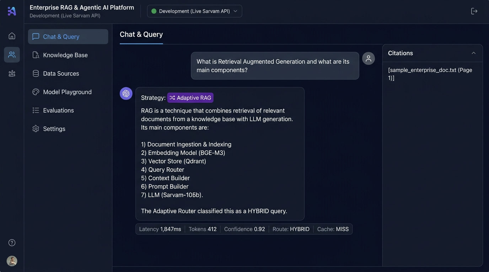

# Phase 13 — Adaptive RAG

**Feature**: Query intent classifier dynamically routing to optimal RAG pipeline  
**Status**: ✅ Complete  
**Git Branch**: `sarvam-105b-adaptive-rag-v1.0.0-langgraph`  
**Version**: v2.0.0

## What Was Built
- `backend/src/rag/adaptive/strategy.py` — `AdaptiveRAGStrategy`
  - Classifies query complexity: `BASIC` | `HYBRID` | `MULTI_QUERY` | `RERANKED`
  - Routes to optimal strategy without user intervention
  - Tracks: route chosen, confidence score, reason, latency, cost
- Unit tests: `backend/tests/unit/test_adaptive_rag.py`

## Screenshot Proof

