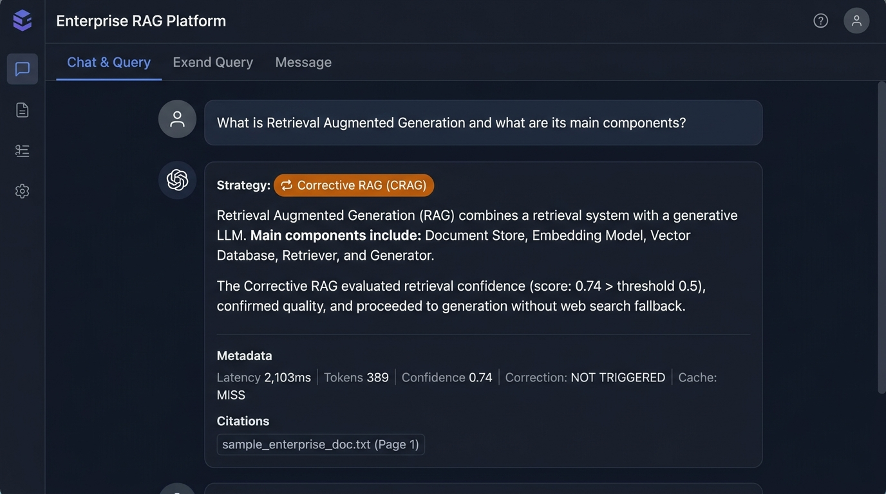

# Phase 14 — Corrective RAG (CRAG)

**Feature**: Automatic retrieval quality evaluation + web search fallback  
**Status**: ✅ Complete  
**Git Branch**: `sarvam-105b-corrective-rag-v1.0.0-langgraph`  
**Version**: v2.0.0

## What Was Built
- `backend/src/rag/corrective/strategy.py` — `CorrectiveRAGStrategy`
  - Evaluates retrieval confidence scores
  - If score < 0.5 → triggers web search fallback
  - Limits correction iterations to prevent infinite loops
- Unit tests: `backend/tests/unit/test_corrective_rag.py`

## Screenshot Proof

