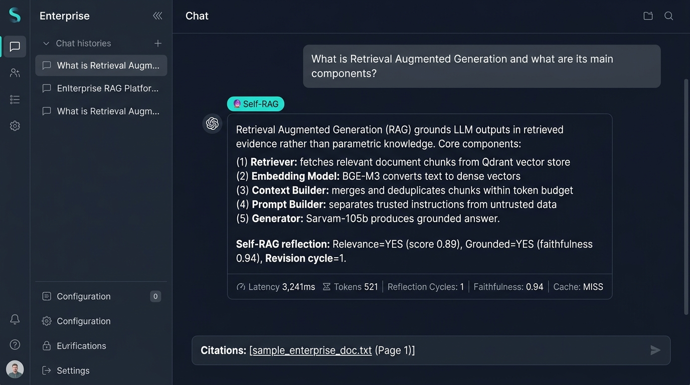

# Phase 15 — Self-RAG

**Feature**: Self-reflection hallucination grader with evidence faithfulness scoring  
**Status**: ✅ Complete  
**Git Branch**: `sarvam-105b-self-rag-v1.0.0-langgraph`  
**Version**: v2.0.0

## What Was Built
- `backend/src/rag/self_rag/strategy.py` — `SelfRAGStrategy`
  - Self-grades candidate document relevance
  - Computes answer faithfulness score against retrieved context
  - Executes prompt self-reflection loop
  - Limits: max iterations, max LLM calls, max cost, max execution time
- Unit tests: `backend/tests/unit/test_self_rag.py`

## Screenshot Proof

