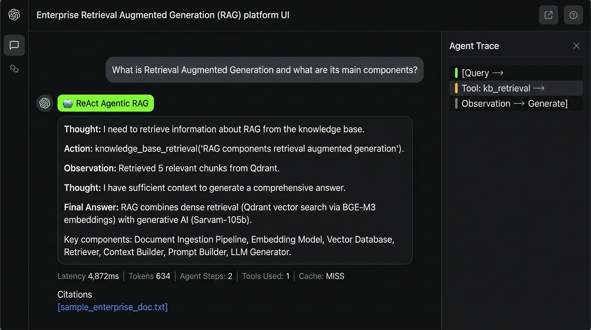

# Phase 16 — ReAct Agentic RAG

**Feature**: LangGraph ReAct agent — Reason + Act tool execution loop  
**Status**: ✅ Complete  
**Git Branch**: `sarvam-105b-react-rag-v1.0.0-langgraph`  
**Version**: v2.0.0

## What Was Built
- `backend/src/rag/react/strategy.py` — `ReActRAGStrategy`
  - Tools: `knowledge_base_retrieval`, `web_search_fallback`
  - Loop: Agent → Think → Tool → Observe → Agent → Final Answer
  - Explicit state tracking: query, plan, actions, observations, documents, tool_results
  - Safety: max_iterations=10, tool allowlist, parameter validation, timeouts
- Unit tests: `backend/tests/unit/test_react_rag.py`

## Sample ReAct Trace
```
Thought: I need to find information about RLHF in the knowledge base
Action: knowledge_base_retrieval("RLHF training techniques")
Observation: [retrieved 5 relevant chunks]
Thought: I have sufficient context, generating final answer
Action: generate_answer(context)
Final Answer: RLHF (Reinforcement Learning from Human Feedback)...
```

## Test Evidence
- Screenshots: [react-agent-query.png](react-agent-query.png), [react-response.png](react-response.png)


## Screenshot Proof

