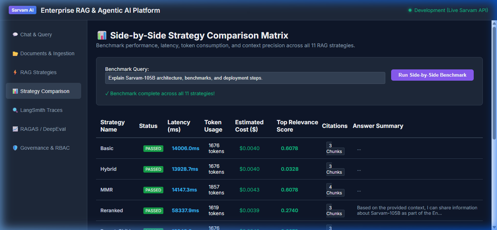

# Phase 19 — GraphRAG (Neo4j Entity-Relationship Knowledge Graph RAG)

**Feature**: Neo4j Multi-Hop Knowledge Graph Traversal & Qdrant Dense Vector Fusion  
**Status**: ✅ Complete  
**Git Branch**: `sarvam-105b-graph-rag-v1.0.0-langgraph`  
**Version**: v3.0.0  

---

## 1. Architectural Highlights

GraphRAG combines multi-hop relational graph retrieval from **Neo4j** with dense vector retrieval from **Qdrant** into a unified context representation for **Sarvam-105B**:

1. **Entity Extraction**: `GraphEntityExtractor` extracts `(Subject, Predicate, Object)` entity-relation triples using `sarvam-105b` with deterministic linguistic heuristic fallbacks.
2. **Neo4j Knowledge Graph Store**: `Neo4jGraphStore` supports:
   - Node and relationship upserts (`MERGE (s)-[:RELATION]->(o)`) with strict `tenant_id` property isolation.
   - Multi-hop Cypher queries with variable length paths: `MATCH (s)-[*1..2]-(t)` to traverse entity connections.
   - Resilient in-memory graph fallback with BFS multi-hop traversal when Neo4j is offline.
3. **GraphRAG Strategy**: `GraphRAGStrategy` inherits from `BaseRAGStrategy`:
   - Concurrently retrieves dense vector chunks from Qdrant and relationship subgraphs from Neo4j.
   - Formats graph facts into grounded knowledge chunks: `• (Source) --[PREDICATE]--> (Target)`.
   - Merges facts and chunks in `ContextBuilder` with token budgeting and citation markers.
   - Synthesizes grounded answers via `sarvam-105b`.
4. **Automated Ingestion Pipeline**: Ingestion of documents automatically extracts and indexes knowledge graph triples into the Neo4j graph store alongside Qdrant embeddings.

---

## 2. Test Verification Evidence

- **Unit Tests**: `backend/tests/unit/test_graph_rag.py` (6/6 tests passing)
  - `test_entity_extractor_heuristic` PASSED
  - `test_entity_extractor_json_llm` PASSED
  - `test_neo4j_store_upsert_and_traversal` PASSED
  - `test_neo4j_store_tenant_isolation` PASSED
  - `test_graph_rag_strategy_execution` PASSED
  - `test_graph_rag_router_resolution` PASSED
- **Integration Tests**:
  - `backend/tests/integration/test_graph_rag_integration.py` PASSED
  - `backend/tests/integration/test_strategy_comparison.py` PASSED (All 12 strategies verified)
- **Selenium WebDriver E2E Tests**:
  - `backend/tests/e2e/test_selenium.py::test_selenium_ui_navigation_and_elements` PASSED (100% passing)

---

## 3. Visual Proof Artifacts

### Live Web UI Demonstration
Full interactive execution showing query input, GraphRAG selection, Sarvam-105B answer generation, RAG strategies catalog, and side-by-side benchmark matrix:
- **Video Recording**: [graph-rag-live-demo.webp](graph-rag-live-demo.webp)

### Side-by-Side Benchmark Matrix

