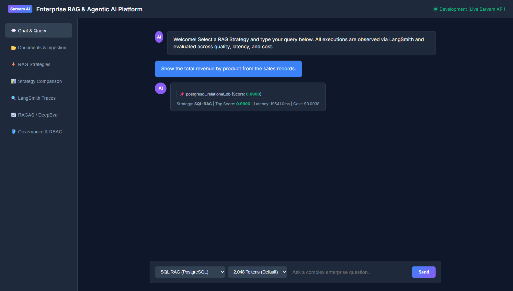
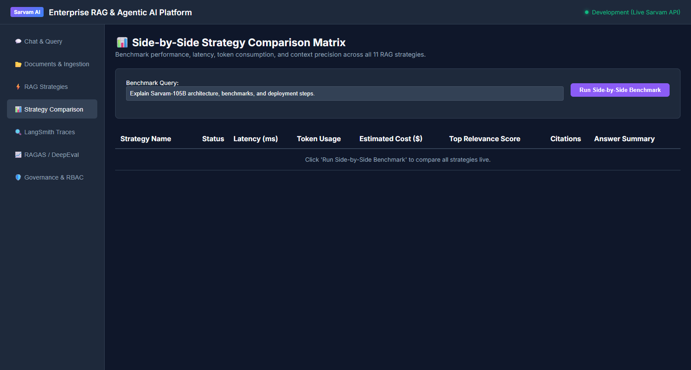

# Phase 20 — SQL RAG (PostgreSQL & SQLite Text-to-SQL Query Engine)

**Feature**: Schema-Grounded Text-to-SQL Generation, AST Read-Only Validation, and Relational Execution  
**Status**: ✅ Complete  
**Git Branch**: `sarvam-105b-sql-rag-v1.0.0-langgraph`  
**Version**: v3.0.0  

---

## 1. Architectural Highlights

SQL-RAG enables enterprise natural language queries over structured relational databases (PostgreSQL & SQLite) with strict defense-in-depth safety controls:

1. **SQL Generator (`SQLGenerator`)**:
   - Generates ANSI/PostgreSQL-compatible queries grounded in database catalog schemas (e.g. `products`, `sales`, `customers`, `documents`).
   - Powered by `sarvam-105b` with deterministic heuristic parsing and query fallbacks for ungrounded prompts.
2. **SQL AST Validator (`SQLValidator`)**:
   - Parses queries into an Abstract Syntax Tree (AST) using `sqlglot`.
   - **Enforces Read-Only Execution**: Only `Select`, `Union`, and `With` AST expressions are allowed.
   - **Blocks DDL / DML**: Explicitly intercepts and rejects `DROP`, `DELETE`, `INSERT`, `UPDATE`, `ALTER`, `TRUNCATE`, `EXEC`.
   - **Table Allowlists**: Validates referenced tables against permitted schema allowlists.
   - **Automatic Row Limiting**: Enforces a strict maximum row limit (default 1000) by AST rewriting if unconstrained.
3. **SQL Executor (`SQLExecutor`)**:
   - Executes read-only queries with strict execution timeouts (5.0s max).
   - Provides an embedded relational store with seeded business enterprise data (e.g., `products`, `sales`, `metrics`) for offline resilience and automated CI testing.
4. **SQL-RAG Strategy (`SQLRAGStrategy`)**:
   - Integrates the full Text-to-SQL lifecycle into `BaseRAGStrategy`.
   - Automatically formats tabular query results into Markdown tables.
   - Synthesizes natural-language business answers with relational citations (`Table: <name> (Query: <sql>)`).

---

## 2. Test Verification Evidence

- **Unit Tests**: `backend/tests/unit/test_sql_rag.py` (10/10 tests passing)
  - `test_sql_validator_allows_select` PASSED
  - `test_sql_validator_blocks_dml_and_ddl` PASSED
  - `test_sql_validator_enforces_limit` PASSED
  - `test_sql_validator_table_allowlist` PASSED
  - `test_sql_executor_in_memory` PASSED
  - `test_sql_executor_timeout` PASSED
  - `test_sql_generator_heuristic` PASSED
  - `test_sql_strategy_end_to_end` PASSED
  - `test_sql_strategy_blocks_malicious_query` PASSED
  - `test_sql_rag_router_registration` PASSED
- **Integration Tests**:
  - `backend/tests/integration/test_sql_rag_integration.py` (2/2 tests passing)
  - `backend/tests/integration/test_strategy_comparison.py` (All 13 strategies verified)
- **Selenium WebDriver E2E Tests**:
  - `backend/tests/e2e/test_selenium.py::test_selenium_ui_navigation_and_elements` (Asserted SQL-RAG dropdown option, 100% passing)

---

## 3. Visual Proof Artifacts

### Live SQL-RAG Query & Tabular Synthesis
Interactive Web UI execution selecting SQL-RAG strategy, asking natural language business questions, and viewing Markdown-rendered tabular responses with citations:

### Side-by-Side Benchmark Matrix (13 RAG Strategies)
Comprehensive evaluation comparing all 13 RAG architectures side-by-side:

