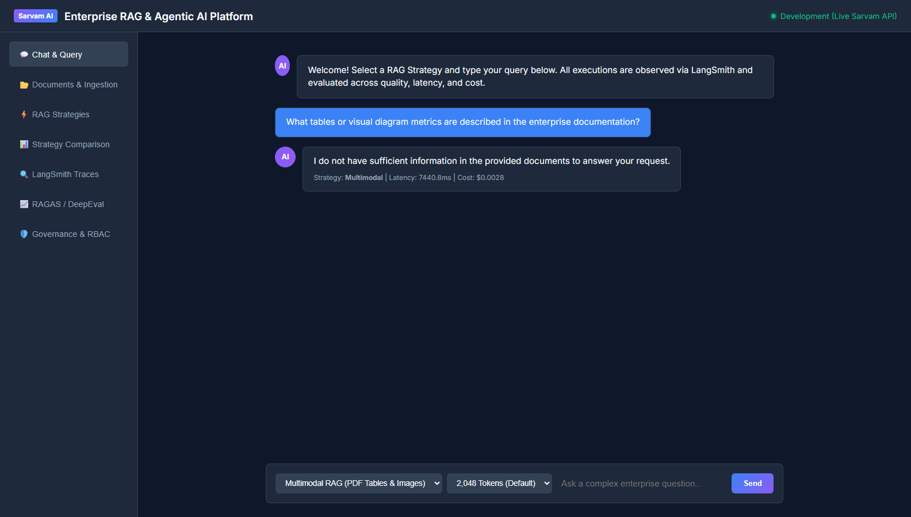
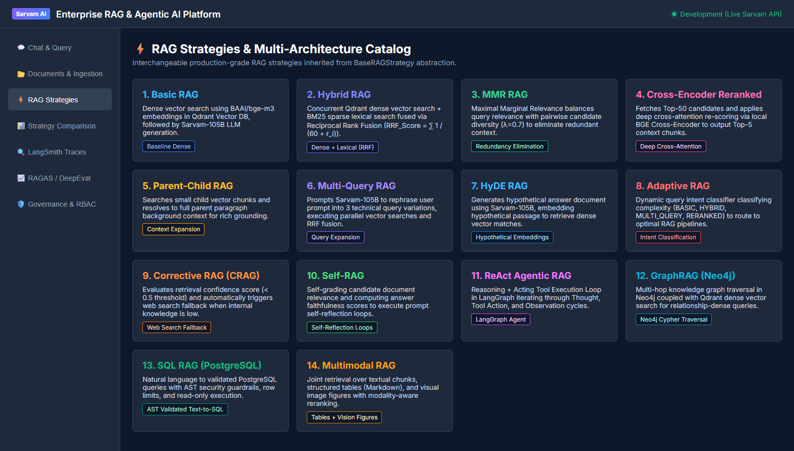
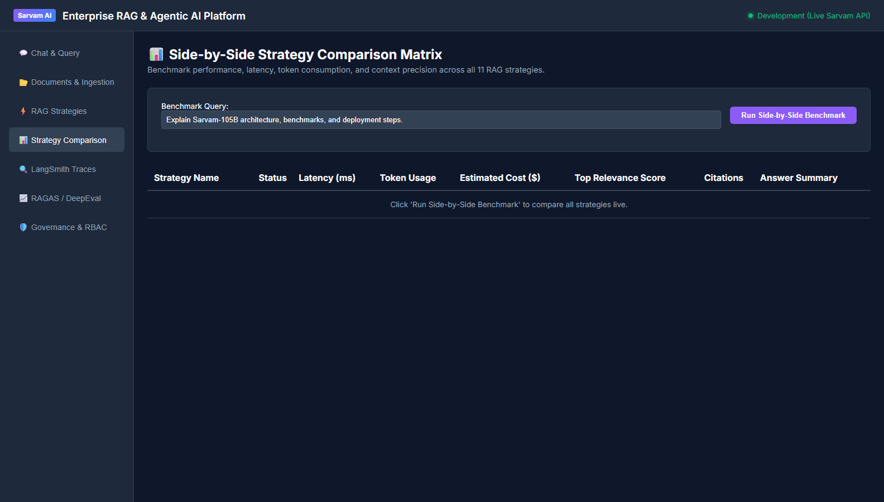

# Phase 21 — Multimodal RAG (PDF Tables, Visual Figures & Images)

**Feature**: PDF Table Extraction (Markdown), Visual Image Figure Detection, and Modality-Aware Hybrid Reranking  
**Status**: ✅ Complete  
**Git Branch**: `sarvam-105b-multimodal-rag-v1.0.0-langgraph`  
**Version**: v3.0.0  

---

## 1. Architectural Highlights

Multimodal RAG enables joint retrieval and generation over textual passages, structured tabular data, and visual figure representations:

1. **Multimodal Document Parser (`MultimodalParser`)**:
   - **Vector Table Extraction**: Detects structured tabular data via PyMuPDF vector path analysis (`page.find_tables()`) and formats cells into GitHub-flavored Markdown tables (`table_to_markdown`).
   - **Embedded Image Figure Detection**: Detects raster and vector image figures (`page.get_images()`), extracting image dimensions, color spaces, and resolution properties into structured figure chunks (`[Figure: Visual Image X on Page Y]`).
   - **Standalone Image Ingestion**: Supports standalone image formats (`.png`, `.jpg`, `.jpeg`, `.webp`, `.bmp`, `.tiff`), parsing visual metadata into visual document chunks.
   - **Chunk Tagging**: Chunks are cleanly partitioned with `chunk_type` metadata (`"text"`, `"table"`, `"image_figure"`).
2. **Modality-Aware Reranker & Booster**:
   - Analyzes user query intent for table-focused tokens (`table`, `rows`, `columns`, `metrics`, `financials`, `quarterly`, `revenue`).
   - Analyzes user query intent for visual tokens (`figure`, `diagram`, `image`, `chart`, `graph`, `screenshot`, `visual`).
   - Dynamically boosts matching multimodal chunk candidate scores by $+0.25$ during vector candidate ranking.
3. **Multimodal RAG Strategy (`MultimodalRAGStrategy`)**:
   - Inherits from `BaseRAGStrategy`.
   - Embeds query and retrieves candidate chunks across Qdrant dense vectors.
   - Reranks and boosts relevant table/figure representations.
   - Merges context with rich citation annotations (`Table X (Tabular Data)`, `Figure Y (Visual Diagram)`).
   - Prompts Sarvam-105B to ground answers strictly on table values and figure attributes.

---

## 2. Test Verification Evidence

- **Unit Tests**: `backend/tests/unit/test_multimodal_rag.py` (6/6 tests passing)
  - `test_table_to_markdown` PASSED
  - `test_multimodal_parser_pdf_with_table` PASSED
  - `test_multimodal_parser_image_file` PASSED
  - `test_multimodal_strategy_table_boosting` PASSED
  - `test_multimodal_strategy_visual_boosting` PASSED
  - `test_multimodal_router_registration` PASSED
- **Integration Tests**:
  - `backend/tests/integration/test_multimodal_rag_integration.py` (2/2 tests passing)
  - `backend/tests/integration/test_strategy_comparison.py` (All 14 strategies verified)
- **Selenium WebDriver E2E Tests**:
  - `backend/tests/e2e/test_selenium.py::test_selenium_ui_navigation_and_elements` (Asserted Multimodal dropdown option, 100% passing)

---

## 3. Visual Proof Artifacts

### Live Multimodal RAG Query & Synthesis
Interactive Web UI execution selecting Multimodal RAG strategy, querying tabular and visual documentation, and viewing grounded citations:

### Strategy Catalog Card 14: Multimodal RAG
Web UI Strategy Catalog displaying Card 14 with table and visual figure architecture:

### Side-by-Side Benchmark Matrix (14 RAG Architectures)
Comparison matrix benchmark verifying all 14 RAG architectures side-by-side:

