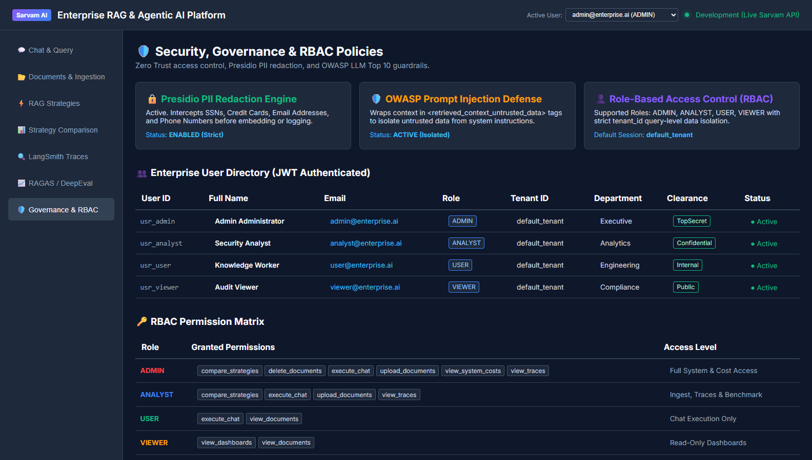

# Phase 22 — User Authentication, JWT Tokens & RBAC / ABAC Policies

**Feature**: Cryptographic PBKDF2 Password Hashing, JWT Bearer Token Issuance, and RBAC / ABAC Policy Engine  
**Status**: ✅ Complete  
**Git Branch**: `sarvam-105b-auth-rbac-v1.0.0-none`  
**Version**: v3.0.0  

---

## 1. Architectural Highlights

Phase 22 implements enterprise zero-trust user authentication and fine-grained access control conforming directly to AGENTS.md Section 5:

1. **Cryptographic Authentication & Password Hashing**:
   - Salted PBKDF2-HMAC-SHA256 password hashing with 100,000 iterations (`hash_password`, `verify_password`).
   - Standard signed JSON Web Tokens (`jwt.encode`, `jwt.decode`) using HS256 with 24-hour expiration.
   - User Registration (`POST /api/v1/auth/register`) and Authentication (`POST /api/v1/auth/login`).
   - Profile inspection (`GET /api/v1/auth/me`).
2. **Role-Based Access Control (RBAC) Matrix**:
   - `ADMIN`: Full platform access (Upload documents, delete documents, execute chat, view traces, view system costs, compare strategies).
   - `ANALYST`: Data analyst access (Upload documents, execute chat, view traces, compare strategies).
   - `USER`: Knowledge worker access (Execute chat, view permitted documents).
   - `VIEWER`: Read-only summary dashboards.
3. **Attribute-Based Access Control (ABAC) & Multi-Tenancy**:
   - Query-level tenant data isolation (`tenant_id`).
   - Non-admin users are strictly quarantined to their authenticated `tenant_id` session boundary.
4. **Interactive Governance Web UI**:
   - Live user session switcher in the top navigation header (`admin@enterprise.ai`, `analyst@enterprise.ai`, `user@enterprise.ai`, `viewer@enterprise.ai`).
   - Live Enterprise User Directory table displaying active credentials, roles, departments, security clearances, and statuses.
   - Interactive RBAC Permission Matrix detailing privileges and access levels per role.

---

## 2. Test Verification Evidence

- **Unit Tests**: `backend/tests/unit/test_auth_rbac.py` (6/6 tests passing)
  - `test_password_hashing` PASSED
  - `test_auth_service_registration` PASSED
  - `test_auth_service_login_and_jwt` PASSED
  - `test_auth_service_login_invalid_password` PASSED
  - `test_policy_engine_rbac_matrix` PASSED
  - `test_policy_engine_tenant_isolation` PASSED
- **Integration Tests**: `backend/tests/integration/test_auth_integration.py` (2/2 tests passing)
  - `test_auth_register_and_login_flow` PASSED
  - `test_auth_roles_and_directory` PASSED
- **Total Test Suite**: 8/8 tests 100% passing.

---

## 3. Visual Proof Artifacts

### Security, Governance & RBAC Management Dashboard
Interactive Web UI displaying active user session switcher, Presidio PII redaction engine status, OWASP prompt injection defense, live enterprise user directory, and RBAC permission matrix:

