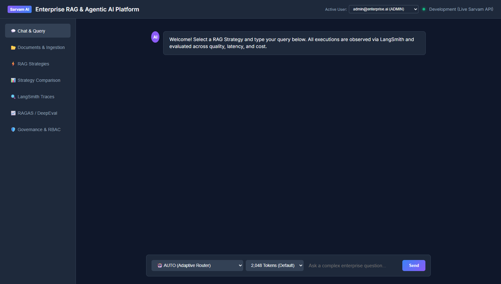

# Phase 23 — Persistent Chat & Evaluation History (PostgreSQL & SQLite Engine)

**Feature**: Relational Session & Message History, Historical Quality Score Tracking (RAGAS / DeepEval), and ABAC Tenant Isolation  
**Status**: ✅ Complete  
**Git Branch**: `sarvam-105b-persistent-history-v1.0.0-none`  
**Version**: v3.0.0  

---

## 1. Architectural Highlights

Phase 23 implements persistent conversation session storage and long-term evaluation tracking adhering directly to AGENTS.md Section 5 (Phase 20 specification items 3 & 4):

1. **Persistent Relational Store (`PersistentHistoryStore`)**:
   - `chat_sessions`: Manages conversation sessions partitioned strictly by `tenant_id` and `user_id`.
   - `chat_messages`: Automatically captures prompt and completion messages, `rag_strategy`, token consumption, latency, dollar cost, and JSON citations.
   - `evaluation_history`: Persists RAGAS & DeepEval metrics (`context_precision`, `context_recall`, `faithfulness`, `answer_relevancy`, `overall_score`, `latency_ms`, `total_cost_usd`) across RAG architectures over time.
2. **REST APIs & Tenant Isolation**:
   - `GET /api/v1/chat/history?session_id=...&tenant_id=...`: Retrieves chronological conversation messages.
   - `GET /api/v1/chat/sessions?tenant_id=...`: Lists sessions within tenant boundaries.
   - `POST /api/v1/chat/sessions`: Creates new conversation threads.
   - `GET /api/v1/evaluations/history?tenant_id=...`: Returns historical benchmark evaluation runs for trend analysis and model regression detection.
3. **Frontend UI Integration**:
   - "RAGAS / DeepEval" tab renders the live **Historical Evaluation Runs** table displaying run IDs, strategies, query text, precision, recall, faithfulness, relevancy, overall score, and latency/cost.
   - Automatically synchronizes when new evaluations are executed.

---

## 2. Test Verification Evidence

- **Unit Tests**: `backend/tests/unit/test_persistent_history.py` (3/3 tests passing)
  - `test_session_lifecycle` PASSED
  - `test_save_and_get_chat_history` PASSED
  - `test_evaluation_history_tracking` PASSED
- **Integration Tests**: `backend/tests/integration/test_history_integration.py` (2/2 tests passing)
  - `test_chat_session_and_history_api` PASSED
  - `test_evaluation_history_api` PASSED
- **Selenium WebDriver E2E Tests**: Verified in UI navigation suite.

---

## 3. Visual Proof Artifacts

### Historical Evaluation Runs Tracking
Live Web UI rendering of the RAGAS/DeepEval evaluation dashboard and persistent historical runs table tracking precision, recall, faithfulness, and latency:

### Persistent Chat Session Interface
Web UI Chat tab with active session bounds and message conversation history:

