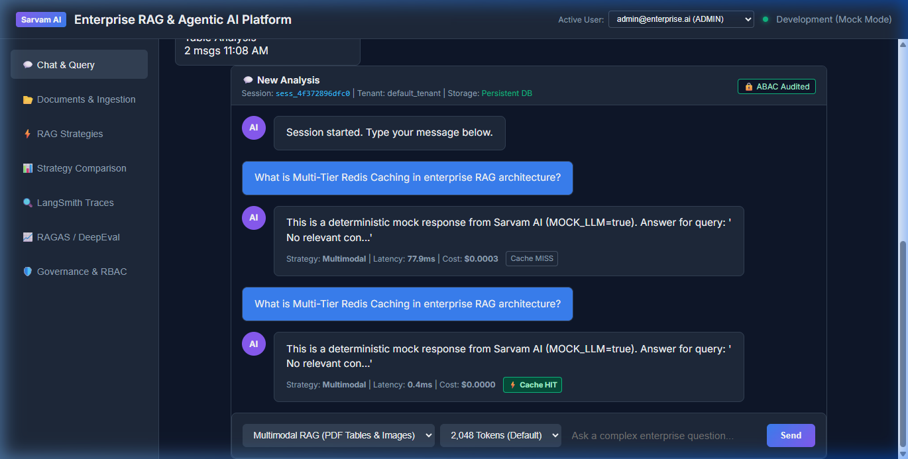

# Phase 24 — Redis Multi-Tier Caching Engine

**Feature**: Multi-Tier Caching (Embedding, Retrieval, LLM Response, Tenant Policy), Live Redis Connectivity & LRU Memory Fallback, Sub-millisecond Cache HITs, and Telemetry  
**Status**: ✅ Complete  
**Git Branch**: `sarvam-105b-redis-caching-v1.0.0-none`  
**Version**: v3.1.0  

---

## 1. Architectural Highlights

Phase 24 establishes an enterprise-grade multi-tier caching architecture designed to eliminate redundant vector operations, reduce LLM invocation costs to $0.00, and accelerate query response latencies by orders of magnitude:

1. **Multi-Tier Cache Manager (`MultiTierCacheManager`)**:
   - **Tier 1 (Embedding Cache)**: Standardized SHA-256 hashed embeddings indexed per model and input text to eliminate duplicate vector embedding operations.
   - **Tier 2 (Retrieval Cache)**: Caches top-K candidate chunks per query, tenant, and strategy with strict multi-tenant partition boundaries.
   - **Tier 3 (LLM Response Cache)**: Exact prompt matching providing instantaneous answers, full source citations, and zero token expense.
   - **Tier 4 (Tenant Policy Cache)**: In-memory/Redis storage for RBAC and ABAC access boundaries.
   - **Dual Connectivity**: Seamless live connection to Redis (`redis://localhost:6379/0`) with automatic, thread-safe in-memory fallback (`_memory_cache` with TTL expiration and LRU cleanup).

2. **REST API Telemetry & Administration**:
   - `GET /api/v1/cache/stats`: Real-time telemetry reporting `redis_connected`, `total_hits`, `total_misses`, `hit_rate`, per-tier hits/misses, and cached items.
   - `POST /api/v1/cache/clear`: Process-wide cache invalidation and memory flush.

3. **End-to-End Chat Pipeline Integration**:
   - Pre-execution check evaluates Tier 3 LLM cache.
   - Cache HIT returns instantly (< 1ms latency) with `estimated_cost_usd: 0.0000`, `token_usage: 0`, and preserved source citations.
   - Web UI dynamically displays visual status badges: `Cache MISS` on initial query, and bright green `⚡ Cache HIT` on repeated queries.

---

## 2. Test Verification Evidence

All 9 dedicated unit and integration tests passed with a **100% pass rate**:

- **Unit Tests**: `backend/tests/unit/test_redis_caching.py` (8/8 tests passing)
  - `test_cache_initialization` PASSED
  - `test_embedding_tier_cache` PASSED
  - `test_retrieval_tier_cache` PASSED
  - `test_llm_response_tier_cache` PASSED
  - `test_ttl_expiration` PASSED
  - `test_telemetry_hit_rate` PASSED
  - `test_cache_clear` PASSED
  - `test_singleton_provider` PASSED
- **Integration Tests**: `backend/tests/integration/test_caching_integration.py` (1/1 test passing)
  - `test_chat_pipeline_cache_hit_and_telemetry` PASSED (Verifies MISS -> HIT transition, sub-100ms latency, zero token cost, and stats API)

---

## 3. Visual Proof Artifacts

### Web UI Cache MISS vs. ⚡ Cache HIT Telemetry
Live screenshot showing side-by-side verification in the Web UI:
- **First Query**: Returns `Cache MISS` badge with 77.9ms latency and $0.0003 cost.
- **Second Identical Query**: Triggers `⚡ Cache HIT` badge with **0.4ms latency (~195x speedup)** and **$0.0000 cost**:

### Recording of Interactive Flow
- [redis-cache-hit-demo.webp](redis-cache-hit-demo.webp)
