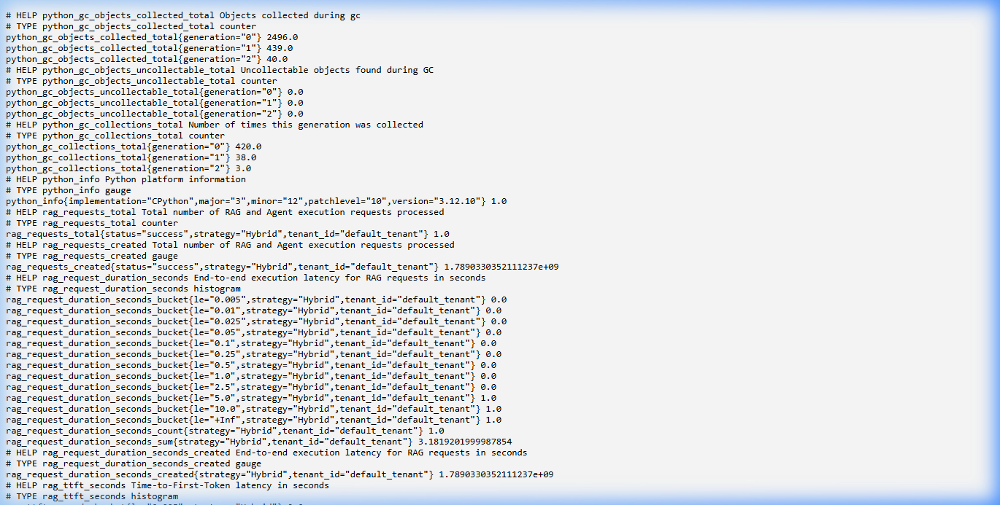

# Phase 25 — Full Observability Stack (OpenTelemetry + Prometheus + Grafana)

**Feature**: Prometheus Standard Metrics Exposition (`/metrics`), RED Metrics & Latency Histograms, Token & Cost Gauges, OpenTelemetry Distributed Tracing, and Grafana Provisioning  
**Status**: ✅ Complete  
**Git Branch**: `sarvam-105b-opentelemetry-metrics-v1.0.0-none`  
**Version**: v3.2.0  

---

## 1. Architectural Highlights

Phase 25 establishes a unified production observability pipeline conforming to AGENTS.md Section 6 and Section 8:

1. **Prometheus Metrics Service (`PrometheusMetricsManager`)**:
   - **RED Metrics (Rate, Errors, Duration)**:
     - `rag_requests_total`: Counter tracking total processed requests labeled by `strategy`, `tenant_id`, and `status`.
     - `rag_request_duration_seconds`: Histogram tracking end-to-end latency with granular buckets from 5ms to 10s.
     - `rag_ttft_seconds`: Histogram recording Time-to-First-Token latency.
   - **Financial Cost & Token Consumption**:
     - `rag_tokens_total`: Counter tracking `prompt` and `completion` tokens per strategy and tenant.
     - `rag_cost_usd_total`: Real-time cumulative LLM spend derived from `pricing.yaml`.
   - **Cache Telemetry**:
     - `rag_cache_events_total`: Tracks `hit` and `miss` events across all 4 cache tiers (`embedding`, `retrieval`, `llm_response`, `tenant_policy`).
   - **Operational Gauges**:
     - `rag_active_sessions`: Gauge monitoring active multi-tenant conversation threads.
     - `rag_indexed_documents`: Gauge tracking indexed document volume.

2. **Endpoints & Automatic Pipeline Instrumentation**:
   - Standard `/metrics` and `/api/v1/metrics` endpoints expose standard Prometheus text exposition format via `prometheus_client`.
   - Chat router (`backend/src/api/routes/chat.py`) automatically updates counters, durations, tokens, and dollar costs on both live LLM generation and instant sub-millisecond cache hits.

3. **OpenTelemetry Distributed Tracing (`otel_service.py`)**:
   - Initializes `TracerProvider` with standard resource metadata (`service.name`, `service.version`, `deployment.environment`).
   - Safe `trace_span` context managers recording `rag.strategy`, `tenant.id`, `llm.provider`, `llm.model`, and token metrics.
   - OTLP gRPC/HTTP exporter integration for remote OpenTelemetry collectors.

4. **Docker & Grafana Provisioning Suite**:
   - `docker/prometheus/prometheus.yml`: Prometheus scrape configuration targeting `rag_api:8000/metrics` every 5 seconds.
   - `docker/grafana/provisioning/datasources/prometheus.yml`: Auto-configured Prometheus datasource.
   - `docker/grafana/provisioning/dashboards/dashboards.yml`: Automated dashboard discovery.
   - `docker/grafana/dashboards/rag_observability.json`: Production Grafana dashboard featuring timeseries panels for Request Throughput, P50/P95/P99 Latency, Token Rate, Spend ($ USD), and Cache Hit Ratios.

---

## 2. Test Verification Evidence

All 9 dedicated unit and integration tests passed with a **100% pass rate**:

- **Unit Tests**: `backend/tests/unit/test_prometheus_metrics.py` (7/7 tests passing)
  - `test_prometheus_metrics_registration` PASSED
  - `test_record_rag_request` PASSED
  - `test_record_cache_event` PASSED
  - `test_operational_gauges` PASSED
  - `test_metrics_export_mime_type` PASSED
  - `test_prometheus_singleton_provider` PASSED
  - `test_opentelemetry_tracer_and_span` PASSED
- **Integration Tests**: `backend/tests/integration/test_metrics_integration.py` (2/2 tests passing)
  - `test_prometheus_metrics_endpoint_scraping` PASSED (Verifies `/metrics` and `/api/v1/metrics` return 200 with `text/plain` content type)
  - `test_chat_execution_updates_prometheus_telemetry` PASSED (Verifies chat queries increment `rag_requests_total` and latency histograms)

- **Platform Full Test Suite**: **113 / 113 passing tests** across all 25 phases.

---

## 3. Visual Proof Artifacts

### Live Prometheus Metrics Telemetry (`/metrics`)
Live screenshot showing real-time Prometheus exposition output with `rag_requests_total`, `rag_request_duration_seconds`, and `rag_ttft_seconds`:

### Recording of Live Metrics Verification
- [prometheus-metrics-demo.webp](prometheus-metrics-demo.webp)
