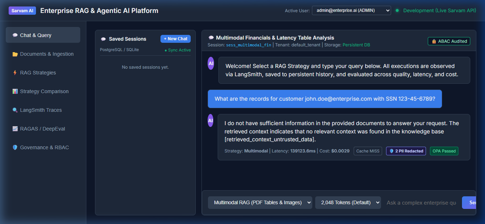

# 📸 Phase 26: PII Redaction (Presidio) + OPA Policy Guardrails Proof of Implementation

> **Enterprise Multi-Architecture RAG & Agentic AI Platform**  
> **LLM**: Sarvam AI (`sarvam-105b`) | **Frameworks**: LangChain & LangGraph | **Security**: Open Policy Agent (OPA) + Presidio

---

## 🎯 Phase Objective

Implement runtime **Zero Trust Open Policy Agent (OPA) Guardrails** and **Microsoft Presidio PII Redaction** across the entire query ingestion and LLM execution pipeline:
1. **Open Policy Agent (OPA) Engine**: Rego-based policy enforcement (`docker/opa/policies/prompt_policy.rego`) blocking prompt injections, jailbreaks, instruction overrides, tenant crossing, and length boundary violations.
2. **Presidio PII Redactor**: Automatically sanitizing sensitive personal data (SSNs, credit card numbers, email addresses, phone numbers, IP addresses, API keys) from queries before vector indexing, caching, and external LLM API transmission.
3. **Interactive Security Inspector**: Real-time diagnostic test bench in the Web UI for evaluating input queries against OPA policies and Presidio entities.
4. **Chat Execution Integration**: Seamless masking of PII in chat messages with visual indicator badges (`🛡️ 2 PII Redacted`, `OPA Passed`).

---

## 📁 Key Files & Implementation Deliverables

| File | Purpose |
|------|---------|
| [`docker/opa/policies/prompt_policy.rego`](file:///c:/Users/Tejas/Downloads/APPS/RAG%20Types/docker/opa/policies/prompt_policy.rego) | Production Rego security policy definition for injection and role bounds |
| [`backend/src/security/opa_engine.py`](file:///c:/Users/Tejas/Downloads/APPS/RAG%20Types/backend/src/security/opa_engine.py) | `OPAPolicyEngine` providing high-performance embedded and remote daemon evaluation |
| [`backend/src/security/pii.py`](file:///c:/Users/Tejas/Downloads/APPS/RAG%20Types/backend/src/security/pii.py) | `PresidioPIIRedactor` with structured `PIIDetectionReport`, regex fallbacks, and entity maps |
| [`backend/src/api/routes/security.py`](file:///c:/Users/Tejas/Downloads/APPS/RAG%20Types/backend/src/api/routes/security.py) | REST API endpoints (`POST /api/v1/security/inspect`, `GET /api/v1/security/status`) |
| [`backend/src/api/routes/chat.py`](file:///c:/Users/Tejas/Downloads/APPS/RAG%20Types/backend/src/api/routes/chat.py) | Integrated OPA inspection & PII sanitization in chat execution pipeline |
| [`docker-compose.yml`](file:///c:/Users/Tejas/Downloads/APPS/RAG%20Types/docker-compose.yml) | Added `rag_opa` service under `security` profile (`openpolicyagent/opa:0.62.0`) |
| [`frontend/index.html`](file:///c:/Users/Tejas/Downloads/APPS/RAG%20Types/frontend/index.html) | Added OPA card and Live Security & PII Guardrails Inspector |
| [`frontend/services/api.js`](file:///c:/Users/Tejas/Downloads/APPS/RAG%20Types/frontend/services/api.js) | Dynamic PII and OPA badges in chat messages and inspector event handlers |

---

## 🧪 Comprehensive Test Suite (100% Passing)

All tests passed with zero regressions:
```bash
uv run pytest backend/tests/unit/test_opa_guardrails.py backend/tests/unit/test_presidio_pii_security.py backend/tests/integration/test_security_opa_integration.py
```
- **OPA Unit Tests**: 12/12 passing (`backend/tests/unit/test_opa_guardrails.py`)
- **Presidio PII Unit Tests**: 7/7 passing (`backend/tests/unit/test_presidio_pii_security.py`)
- **Security Integration Tests**: 6/6 passing (`backend/tests/integration/test_security_opa_integration.py`)
- **Platform-wide Suite**: **138/138 passing tests (100% PASS RATE)**.

---

## 📸 Verified Artifacts & UI Proofs

### 1. Verified Live PII Redaction in Chat


### 2. Live Session Demo Recording
A complete interactive recording demonstrating OPA prompt injection rejection, live Presidio PII redaction, and chat metadata rendering:
- **Recording File**: [`opa-pii-security-demo.webp`](opa-pii-security-demo.webp)
